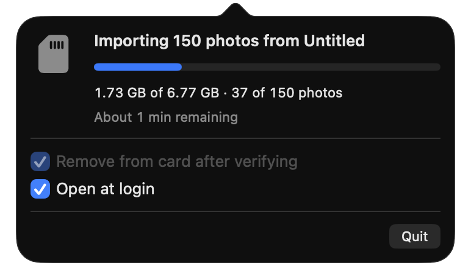

# SD Card Photo Sweeper



**Insert an SD card. That's it.** No clicks, no dialogs, nothing to confirm.

A macOS menu-bar app that, every time a card goes in:

1. Imports its RAW photos into Apple Photos, with a progress bar and an accurate time estimate.
2. Checks each copy in Photos byte for byte against the card.
3. Removes the verified photos from the card, freeing its space.
4. Ejects the card and tells you when it's done.

Anything that can't be verified stays on the card. A photo is never imported twice.

## Install

Needs macOS 14 or later.

```sh
xcode-select --install   # Apple's Command Line Tools, if you don't have them
git clone https://github.com/dion-/sd-card-photo-sweeper.git ~/sd-card-photo-sweeper
~/sd-card-photo-sweeper/build.sh install
```

The first time you insert a card, allow Photos access (both prompts) and notifications. After that it runs on its own, and opens at login.

To update: `git -C ~/sd-card-photo-sweeper pull && ~/sd-card-photo-sweeper/build.sh install`
